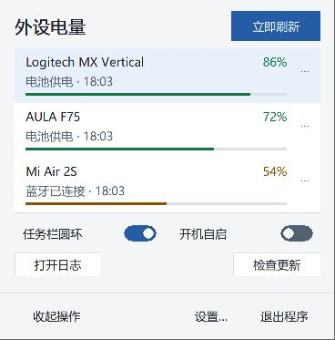
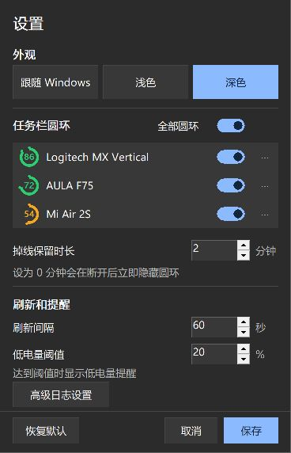

# Peripheral Battery Tray · 外设电量

在 Windows 托盘和任务栏查看无线鼠标、键盘和部分蓝牙耳机的电量。外设有活动时才自动读取电量，悬停可查看上次读数。

## 下载

**[下载 Windows x64 原生版](https://github.com/XiaoHang9527/peripheral-battery-tray/releases/latest/download/peripheral-battery-tray-native.exe)** · [查看发布记录](https://github.com/XiaoHang9527/peripheral-battery-tray/releases)

支持 Windows 10 / 11 x64。下载后直接运行，在通知区域打开概览或设置。左键点击任务栏电量圆环可立即刷新，右键打开概览。

## 界面截图

截图来自原生版 0.1.2，设备和电量为示例数据。

### 设备概览

一眼查看各设备的电量、连接状态和读数时间。展开「更多操作」可以开关任务栏圆环和开机自启，也可以检查更新。

### 设置

可选择跟随 Windows、浅色或深色主题，为单个设备开关任务栏圆环，并调整刷新间隔和低电量阈值。

## 支持的设备

| 品牌 | 型号 | 连接方式与条件 |
| --- | --- | --- |
| AULA 狼蛛 | F75、F99 | 使用 `3554:FA09` 或 `3554:FB40` 的 Compx 2.4 GHz USB 接收器，需上报电量。 |
| Logitech 罗技 | MX Vertical。其他型号按 HID++ 协议识别。 | 通过兼容的 USB 接收器连接，设备需通过 HID++ 2.0 上报精确百分比。 |
| Rapoo 雷柏 | VT3 Pro、VT1 Pro Max、VT0、VT9（第二代）、VT3 Max（第二代） | 2.4 GHz USB 接收器，需匹配对应版本的 [接收器 ID 和报文长度](windows-native/README.md#雷柏接收器匹配)。 |
| Razer 雷蛇 | Viper Ultimate、Mamba Wireless、Basilisk Ultimate、Viper V2 Pro、DeathAdder V3 Pro | 使用对应型号的 2.4 GHz USB 接收器。 |
| Glorious | Model O Wireless、Model D Wireless、Model O- Wireless、Model D- Wireless | 使用对应型号的 2.4 GHz USB 接收器。 |
| WLMouse | YING Magnesium | 使用 `36A7:A874` 的 8K USB 接收器。 |
| 小米 | Mi Air 2S 等兼容的经典蓝牙耳机 | 原生版显示 Windows 上报的耳机整体电量。 |

部分狼蛛 F87 Pro 使用相同的 Compx 协议，兼容性取决于接收器 ID 和电量报文。验证雷柏 M350（`24AE:187B`）电池供电的电量无法读取。

## 源码与文档

- [Windows 原生版源码、设备支持与构建说明](windows-native/)在 `windows-native/`。
- [Python 版源码、运行与维护说明](python/)独立保存在 `python/`，可按目录内的说明运行。
- [项目状态](项目状态.md)记录两版的功能和本地目录。切换版本前，请先从托盘退出当前程序。
