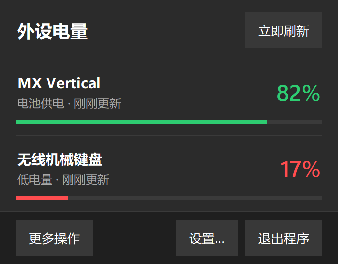
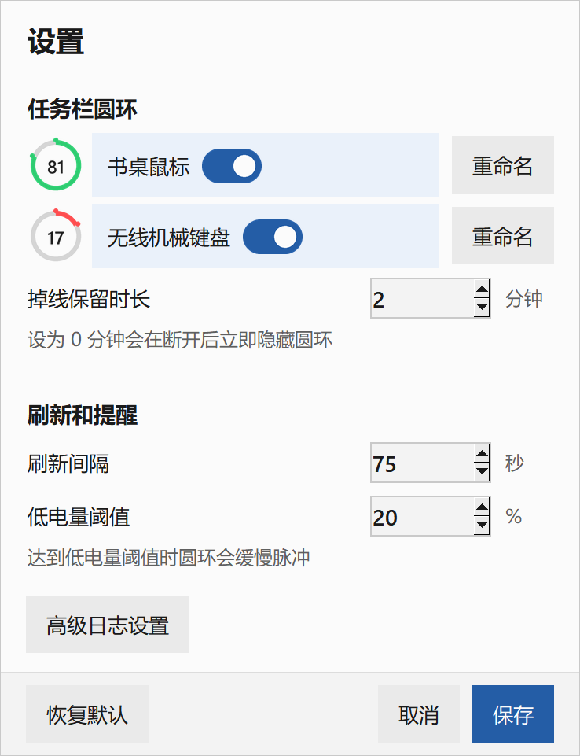

# 外设电量 Python 版

项目主要发行 [C++ / Win32 原生版](../native/README.md)，可在 Windows 上直接运行。下文命令从本目录 `python/` 执行。

Windows 托盘小工具：在任务栏通知区域左侧按设备显示电量圆环，悬停显示型号、电量和状态。

支持以下 2.4G 接收器和电量协议：

- Compx（`3554:FA09` / `3554:FB40`）——读取采用相同电量报文的键盘，包含 AULA F75、F99 及使用该协议的 F87 Pro 版本。当前选择一个兼容键盘接收器。
- Logitech HID++ 2.0——支持 `0x1000` 和提供精确百分比的 `0x1004`，按接收器和配对槽位显示电量与名称。Bolt、Lightspeed 的兼容性取决于接收器和配对设备是否提供上述接口。
- Rapoo VT——被动读取 VT3 Pro、VT1 Pro Max、VT0、VT9（第二代）和 VT3 Max（第二代）匹配接收器的电量上报。M350 的 `24AE:187B` 接收器尚无已验证的电量读取方式。
- Razer——Viper Ultimate、Mamba Wireless、Basilisk Ultimate、Viper V2 Pro、DeathAdder V3 Pro 的指定无线接收器。
- Glorious——Model O / D / O- / D- Wireless。
- WLMouse——YING Magnesium 的 8K 接收器（`36A7:A874`）。

协议资料见 [Compx 和 Rapoo VT 设备支持表](https://github.com/krisgfx9/Wireless-Device-Battery-Monitor#supported-devices)
及 [Linux HID++ 驱动中的统一电量定义](https://github.com/torvalds/linux/blob/master/drivers/hid/hid-logitech-hidpp.c)。
雷蛇和共享 Sinowealth 协议参见 [OpenRazer](https://github.com/openrazer/openrazer)、
[OpenMouse 的实机记录](https://github.com/OpenMouse-Project/mouse-protocol/blob/main/docs/razer-testing.md)
及 [Wireless Battery 的设备适配](https://github.com/krisgfx9/Wireless-Device-Battery-Monitor/blob/main/src/drivers/glorious.cpp)。

## 安装

在 Windows 10 或 11（x64）上，按下方「运行」准备 Python 环境并启动。
首次安装使用 GitHub Release 的源码压缩包或 Git 工作副本。切换版本前，先从托盘退出正在运行的版本。

## 在线更新

打开托盘面板，在「更多操作 → 检查更新」查看 Python 版的更新。程序会从本仓库的 GitHub Releases
下载并校验更新包，确认安装后退出并重新启动。更新只替换程序文件。设置、日志和 Python 环境会保留，
上个版本的程序文件备份在项目内的 `.data/updates/<版本号>-<编号>/backup`。
Git 克隆目录中的同名程序文件也会替换，正在编辑源码时可以取消安装。

发布版本时，将 `app_update.py` 中的 `APP_VERSION` 改为对应版本号，并推送同名 `vX.Y.Z` 标签。
GitHub Actions 会在两版测试通过后发布专用更新包。也可用
`python app_update.py --build v0.1.0 dist/peripheral-battery-tray-update.zip` 在本地构建首个版本的包。

## 界面

任务栏圆环按设备从通知区域往左依次紧排，44px 直径、PIL 4 倍超采样抗锯齿，
在 150% 缩放的高分屏上和系统图标同一档次：

| 状态 | 表现 |
| --- | --- |
| 电量充足 / 偏低 / 低电量 | 绿 / 橙 / 红弧线。红色、脉冲和通知共用设置中的低电量阈值 |
| 充电中 | 蓝色弧线 + 右下角闪电徽标 |
| Compx 已接线 | 圆环显示 `--`，悬停显示「已接线（电量未知）」 |
| 低电量（≤ 阈值且未充电） | 弧线缓慢脉冲，数字保持清晰 |
| 设备还在但没回应（鼠标休眠） | 弧线淡化，颜色不变，圆环一直留着 |
| 设备整个不在了（拔掉/断电） | 淡化 + 斜杠，只保留「掉线保留」时长 |
| 无读数 | 只有轨道和 `--` |

「设备消失」分两种情况，不能一刀切：

* **连着但没回应**（例如鼠标休眠、接收器仍在）：已识别的设备继续显示淡化圆环，
  返回有效读数后恢复正常。未识别的配对槽位会定期重试，也可用「立即刷新」重新探测。
* **整个从设备树上消失**（拔掉、被供电切断）：只保留设置里的「掉线保留」
  时长（默认 **2 分钟**，`0` = 立即隐藏），从程序检测到断开时开始计时。
  保留期内用斜杠标记旧读数，超时后收起，重新检测到接收器时恢复显示。

Compx 接收器在有线模式固定上报 100%。程序保留上一次有效的电池读数，
等键盘切回电池模式再更新百分比。

> 实测这台机器上 Logitech 接收器被 Dock 断电时，连设备树里的 devnode 都会消失，
> 所以「拔掉」与「挂起」无法靠系统信息区分，才需要用时长 + 视觉标记来区分。

悬停圆环可查看当前电量、上次电量或电量未知。左键点击圆环会刷新并立即展开
卡片，显示「正在刷新…」。设备返回读数后显示「刚刚更新」，没有应答时标出上次电量。
自动刷新只读取近期有活动的外设。设备活动恢复后可提前刷新，持续使用时按设置的间隔更新，默认 60 秒。休眠或悬停时保留已读电量。检测不到设备活动时，可用「立即刷新」读取。Logitech Unifying（优联）通过 USB 接收器上的分槽活动计数识别设备，其他受支持的 2.4G 设备通过 Windows 的输入设备标识匹配活动。
悬停卡片按**圆环所在显示器**的工作区收边，并延迟 180ms 显示，方便扫过任务栏。

左键或右键点击系统托盘图标，打开电量面板。设备行显示电量条、百分比、状态和更新时间。
右键点击任务栏圆环会打开同一个面板，将对应设备置顶，并提供它的圆环显示开关。
「立即刷新」「设置」和「退出程序」可直接点击。「更多操作」可展开全局圆环开关、开机自启和日志。
点击面板外或按 `Esc` 收起。设备较多时可滚动查看。
在「设置 → 外观」可选择「跟随 Windows」（默认）、「浅色」或「深色」。
选择后会立即预览设置窗口的配色，点击「取消」或按 `Esc` 可放弃改动。
保存后，电量面板、设置窗口和悬停卡片使用所选主题，任务栏圆环继续随系统任务栏配色。
设备的圆环显示开关仅控制任务栏圆环。托盘图标与提示优先显示需要充电的设备。

设置窗口沿电量面板的入口图标对齐，并使用相同的浅色或深色主题。
设备部分只列出当前检测到的设备，可单独开关圆环或直接点击「重命名」。
圆环预览会淡化旧读数，设置改动点击「保存」后生效。
日志选项在「高级日志设置」里。输入有误时，面板会显示允许范围，并聚焦到第一个错误字段。

### 位置可靠性（开机 / 托盘变化时）

圆环贴着通知区域左边界摆，这件事有几个坑，都做了处理：

- **锚点取「实际渲染出的最左边界」**：开机登录时 `TrayNotifyWnd` 外框会短暂滞后
  于它内部已经画好的图标，只用外框会算出偏右的位置、把圆环盖到图标上。现在取
  该窗口及其可见子窗口左边界的最小值。
- **首次放置要求连续 3 拍一致**：开机瞬间托盘是一张张冒出来的，第一拍就采信会
  定到错误位置（日志 `锚点确定` 会写明等了几拍）。
- **按物理像素定位并校验**：使用原生顶层窗口和 SetWindowPos，每拍校验实际矩形。
  圆环窗口因任务栏重建等原因失效时自动创建，日志会记录窗口重建和显示状态变化。
- **界面循环看门狗**：`ui_tick` 若因异常未能重新排程，`pulse_tick` 发现心跳超过
  6 秒没更新会把它重新拉起（日志 `界面循环停滞`），不会静默冻结在最后一帧。
- **异常落盘**。`pythonw` 没有 stderr，主线程、子线程和 Tk 回调的未捕获异常写入
  `%LOCALAPPDATA%\PeripheralBatteryTray\tray.log`，和其他运行诊断一同轮转。




## 运行

首次运行，在 `python/` 目录执行以下命令。之后可双击 `启动外设电量.cmd`。

```powershell
py -3.12 -m venv .venv
.\.venv\Scripts\python.exe -m pip install -r requirements.txt
.\.venv\Scripts\python.exe peripheral_battery_tray.py
```

依赖为带 Tkinter 的 x64 CPython 3.12–3.14，以及 `requirements.txt`。若项目已配有 `.data/portable-cpython-312/python/pythonw.exe`，启动器会优先使用该便携环境。

用户设置保存在 `%APPDATA%\PeripheralBatteryTray\config.json`，与代码目录无关。
电量快照 `last.json` 和诊断日志 `tray.log` 放在 `%LOCALAPPDATA%\PeripheralBatteryTray\`。
快照只保留最近的读数，启动时匹配本机检测到的接收器后才会使用，读到新电量前标为上次读数。旧的漫游快照停止读取。
日志用于排查运行、窗口定位和异常问题，日常电量采样只更新快照。

如果 Windows 用户目录不可写，程序会将相应的设置或运行数据放到项目下的 `.data/`，该目录已加入 Git 忽略规则。

升级后，旧鼠标的自定义名称和圆环开关会迁移到第一台识别出的 Logitech 指针设备。
各 Logitech 设备独立保存配置与电量。

在电量面板的「更多操作」里勾选「开机自启」，程序入口的绝对路径会写进 `HKCU\...\Run\PeripheralBatteryTray`。
从更名前的版本升级时，先关闭旧版的开机自启并退出旧实例。新版首次启动会从 `%APPDATA%\KBBattery\config.json` 迁移设置，已有新版配置时继续使用新版配置。需要开机自启时，在新版里重新勾选。移动代码目录后也需要重新勾选一次。

## 测试

```
.\.venv\Scripts\python.exe -m pip install -r requirements-test.txt
.\.venv\Scripts\python.exe -B -m pytest tests
```

`tests/conftest.py` 会把 `APPDATA` 和 `LOCALAPPDATA` 指到临时目录，测试使用独立的配置和日志。
`battery_protocols.py`（协议解析）和 `tray_ui.py`（设计令牌、颜色语义、表单校验）都是纯函数，
最适合单测，不需要真机。

## 结构

| 文件 | 作用 |
| --- | --- |
| `peripheral_battery_tray.py` | 应用逻辑：设备轮询、托盘、任务栏面板、开机自启 |
| `tray_ui.py` | UI 层：设计令牌、抗锯齿圆环渲染、悬停卡片、设置面板、表单校验 |
| `compx_battery_cli.py` | Compx 2.4G 接收器电量/型号读取 |
| `hid_transport.py` | HID 设备枚举与可取消的读写（Win32/SetupAPI/ctypes） |
| `battery_protocols.py` | 协议解析（纯函数，不依赖 Win32） |
| `tests/` | pytest 测试 |
| `screenshots/` | 界面截图 |

### 设计约定

- **颜色/间距/尺寸只写在 `tray_ui`**，圆环、托盘图标、卡片、设置面板取同一套令牌，
  避免各处硬编码漂移；数值范围也只写在 `tray_ui.LIMITS`，校验、控件、`log_limits()`
  三处共用，面板改了范围不会漏改落盘逻辑。
- **共用电量面板**。托盘和任务栏圆环复用 `tray_ui.DeviceOverview`，以对应图标为定位锚点。
- **渲染与状态分离**：`tray_ui.ring_image()` 是纯函数（进参数出图像，带缓存），
  `TaskbarPanel` 只负责状态缓存、定位和顶层保持。
- **小尺寸不做伪精细**：托盘图标只有 16–24px，画数字必然糊成一团，因此托盘只留
  圆环颜色，精确百分比交给任务栏圆环和悬停卡片。
- **文案只有一个拼装点**：`describe(dev, with_mode=, with_time=, name_limit=)`
  统一出文案，托盘 tooltip / 菜单标题 / 悬停卡片各自选详细程度。
- **听从系统广播而不是轮询**：隐藏窗口收 `WM_SETTINGCHANGE` / `WM_THEMECHANGED`
  / `WM_DISPLAYCHANGE`，只置标志位，Tk 线程 1 秒内复核并重新着色；另有 5 分钟
  兜底核对，防止广播被吞。
  （注意：`WM_USER` 以下的系统消息不能用 `PostMessage`，会返回
  `ERROR_MESSAGE_SYNC_ONLY`，所以关闭监听窗口用自定义 `WM_APP+1`。）
- **圆环是任务栏的附属窗口**（owned window）：owned window 永远排在宿主之上，
  explorer 点开托盘溢出面板时会把任务栏抬到所有置顶窗口最上面，附属关系让
  圆环自动跟上去。早期靠定时 `SetWindowPos` 抢层级，每次抢都会造成一帧重绘
  空档，实测 1/6 次点击能看到圆环「闪一下」；改成附属窗口后 8/8 次为 0 暗帧。
  定时置顶只留作兜底（宿主关系丢失时）。
